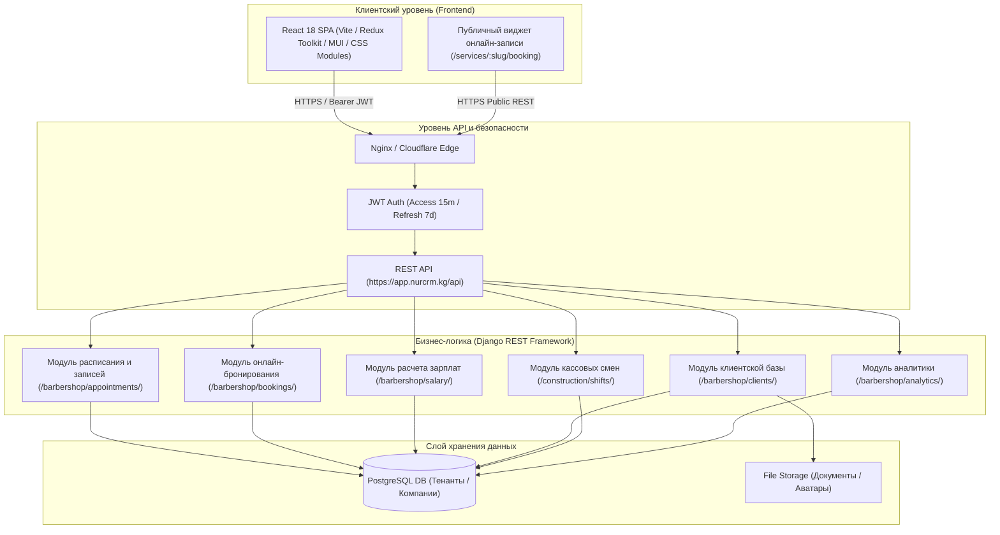
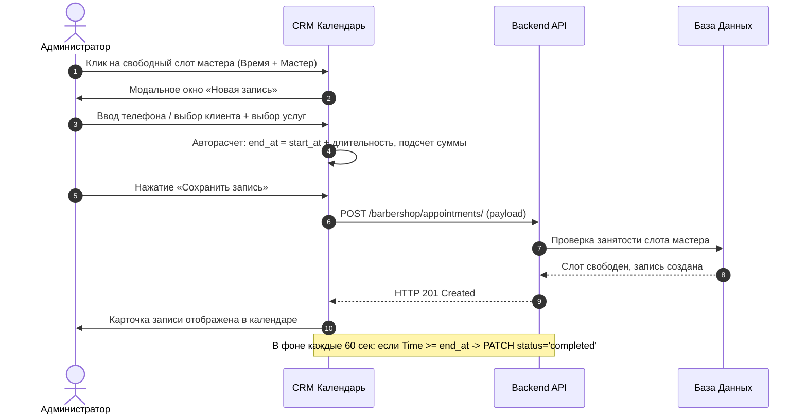
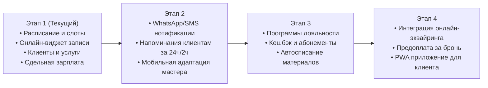

# ТЕХНИЧЕСКОЕ ЗАДАНИЕ (ТЗ)
## Комплексная CRM-система для бизнеса сферы услуг (на базе архитектуры NurCRM)

---

## 1. Общие сведения и назначение системы

### 1.1. Наименование и назначение
Настоящий документ представляет собой Техническое задание (ТЗ) на разработку, внедрение и сопровождение программного комплекса CRM для предприятий **сферы услуг** (Services Sector CRM). Документ составлен на основе детального реверс-инжиниринга, исследования API, логики и реальной базы данных CRM-системы **nurcrm.kg** (аккаунт компании `services`, отрасль «Услуги»).

### 1.2. Целевая аудитория и сферы применения
Система предназначена для автоматизации операционной деятельности предприятий сферы персональных и бытовых услуг:
- Салоны красоты, барбершопы, парикмахерские;
- Массажные салоны и SPA-центры;
- Косметологические клиники и кабинеты эстетической медицины;
- Стоматологические и оздоровительные центры;
- Студии ногтевого сервиса, тату-салоны, груминг и сервисные мастерские.

### 1.3. Цели и задачи внедрения
1. **Автоматизация записи клиентов:** исключение накладок в расписании мастеров, ведение электронного журнала в режиме реального времени.
2. **Привлечение клиентов через онлайн-запись:** внедрение публичного веб-виджета бронирования 24/7 без участия администратора.
3. **Единая база клиентов (CRM):** сохранение истории каждого визита, прикрепление персональных документов и файлов, контроль лояльности.
4. **Прозрачный финансовый учет и зарплата:** сдельная оплата мастеров (% от стоимости оказанных услуг), учет авансов, начислений и выплат.
5. **Кассовый и складской контроль:** фиксация смен, движения денежных средств, списание расходных материалов и продажа сопутствующих товаров.
6. **Управленческая аналитика:** наглядные дашборды для владельца (выручка, средний чек, загрузка мастеров, популярные услуги, конверсия).

---

## 2. Архитектура и стек технологий

### 2.1. Технологический стек
- **Frontend:** React 18, Vite, React Router v6, Redux Toolkit, Axios, Material-UI (MUI), Lucide Icons, FullCalendar / Custom Grid Scheduler.
- **Backend:** Python, Django REST Framework (DRF), SimpleJWT, Multi-tenant Architecture (изоляция данных по `company_id`).
- **База данных:** PostgreSQL с индексацией по датам записей, UUID компаний и телефонным номерам.
- **Интеграция:** Публичный REST API без обязательной авторизации для виджета онлайн-записи клиентов.

---

## 3. Модели данных (ER-спецификация)

### 3.1. Ключевые сущности системы

#### 1. Компания (`Company`)
- `id` (UUID): Уникальный идентификатор тенанта.
- `name` (String): Наименование компании (напр. «services»).
- `slug` (String, Unique): Короткое имя для публичной ссылки онлайн-записи (`nurcrm.kg/services/:slug/booking`).
- `industry` (FK): «Услуги».
- `sector` (FK): «Услуги».
- `appointment_work_start` (Time): Время начала рабочего дня компании (по умолчанию `09:00`).
- `appointment_work_end` (Time): Время окончания рабочего дня компании (напр. `21:00` или `00:00`).
- `subscription_plan` (FK): Текущий тариф (`Стандарт`, `Start`, `Prime` и т.д.).

#### 2. Сотрудник / Мастер (`Employee` / `Master`)
- `id` (UUID): ID сотрудника в системе.
- `first_name` (String): Имя.
- `last_name` (String): Фамилия.
- `email` (String): Логин для входа в систему.
- `phone_number` (String): Контактный телефон.
- `role` (Enum): `owner` (Владелец), `admin` (Администратор), `master` / `custom_role` (Мастер / Специалист).
- `role_display` (String): Название должности (напр. «Массажист», «Барбер», «Косметолог»).
- `avatar` (URL/File): Фотография мастера (отображается клиентам в онлайн-записи).
- `branch_ids` (Array): Привязанные филиалы компании.

#### 3. Категория услуг (`ServiceCategory`)
- `id` (UUID): Идентификатор категории.
- `company` (FK): ID компании.
- `name` (String): Название (напр. «Волосы», «Тело», «Массаж спины»).
- `is_active` (Boolean): Флаг активности.

#### 4. Услуга (`Service`)
- `id` (UUID): Идентификатор услуги.
- `company` (FK): ID компании.
- `category` (FK): Ссылка на `ServiceCategory`.
- `name` (String): Название услуги (напр. «Голова + Шея», «Стрижка классическая»).
- `price` (Decimal): Базовая стоимость в сомах (KGS).
- `time` (Integer/String): Длительность оказания услуги в минутах (напр. `30`, `60`, `90`).
- `barbers` (M2M / Array UUID): Список мастеров, допущенных к оказанию данной услуги.
- `is_active` (Boolean): Доступность для выбора в журнале и онлайн-виджете.

#### 5. Клиент (`Client`)
- `id` (UUID): Идентификатор клиента.
- `company` (FK): ID компании.
- `full_name` (String): ФИО клиента.
- `phone` (String): Телефон в международном формате (проверка на уникальность внутри компании).
- `birth_date` (Date, Nullable): Дата рождения (для персональных поздравлений и бонусов).
- `status` (Enum): `active` (Активный), `blacklist` (В черном списке).
- `notes` (Text, Nullable): Примечания, аллергии, особенности клиента.
- `created_at` (DateTime): Дата первого визита / регистрации.

#### 6. Документ клиента (`ClientDocument`)
- `id` (UUID): ID файла.
- `client` (FK): Ссылка на клиента.
- `file` (FileField): Загруженный файл (договор, мед. карта, согласие, фото «до/после»).
- `file_comment` (String): Описание или комментарий к файлу.
- `created_at` (DateTime): Дата загрузки.

#### 7. Запись в журнале (`Appointment`)
- `id` (UUID): Идентификатор записи.
- `company` (FK): ID компании.
- `client` (FK, Nullable): Зарегистрированный клиент (либо создается «на лету»).
- `client_name` (String): Отображаемое имя клиента.
- `barber` (FK): Назначенный мастер (специалист).
- `services` (M2M / Array UUID): Выбранные услуги.
- `start_at` (DateTime with TZ): Дата и время начала процедуры.
- `end_at` (DateTime with TZ): Дата и время окончания (рассчитывается: `start_at` + сумма длительностей услуг).
- `price` (Decimal): Итоговая стоимость.
- `discount` (Decimal): Размер скидки (% или фикс).
- `status` (Enum):
  - `booked` — предварительная бронь;
  - `confirmed` — подтверждена клиентом / администратором;
  - `completed` — визит успешно завершен (услуга оказана);
  - `canceled` — отменена;
  - `no_show` — клиент не явился.
- `comment` (Text): Комментарий администратора или пожелания клиента.
- `created_at` (DateTime): Дата создания записи.

#### 8. Онлайн-заявка (`BookingRequest`)
- `id` (UUID): ID заявки, поступившей с сайта/виджета.
- `company` (FK): ID компании.
- `client_name` (String): Имя заявителя.
- `client_phone` (String): Телефон заявителя.
- `services` (JSON): Перечень заказанных услуг с длительностью и ценами.
- `master_id` (UUID, Nullable): Выбранный мастер (либо `null` — «Любой мастер»).
- `date` (Date): Желаемая дата.
- `time_start` (Time): Время начала.
- `time_end` (Time): Время окончания.
- `total_price` (Decimal): Предварительная сумма заказа.
- `total_duration_min` (Integer): Суммарная продолжительность.
- `payment_method` (Enum): `cash` (наличные/картой на месте), `online` (эквайринг).
- `client_comment` (Text): Комментарий клиента при записи.
- `status` (Enum): `new` (Новая), `confirmed` (Подтверждена и перенесена в расписание), `no_show` (Не явился), `spam` (Спам/Ошибка).

#### 9. Ставки и расчет зарплаты мастеров (`SalaryRate`, `Accrual`, `Payout`)
- **`SalaryRate`:**
  - `service` (FK): Услуга.
  - `percent` (Float): Процент мастера от стоимости услуги (от 0% до 100%).
- **`SalarySummary`:**
  - `accrued_total`: Начислено мастерам за выполненные услуги.
  - `paid_total`: Фактически выплачено.
  - `balance`: Остаток к выплате сотрудникам.
- **`SalaryPayout`:**
  - `master` (FK): Получатель выплаты.
  - `amount` (Decimal): Сумма выплаты.
  - `date` (Date): Дата выдачи.
  - `comment` (String): Примечание (аванс, расчет за неделю/месяц).

---

## 4. Спецификация функциональных модулей

### 4.1. Модуль «Журнал записей» (Интерактивное расписание)
- **URL интерфейса:** `/crm/services/records`
- **Ключевой функционал:**
  1. **Сетка расписания:** Отображение рабочего дня с шагом в 15/30 минут по колонкам мастеров.
  2. **Создание записи:**
     - Выбор существующего клиента через «живой» поиск по номеру телефона / имени либо создание нового клиента в один клик прямо из модального окна записи.
     - Мультивыбор услуг: автоматическое суммирование цен и времени длительности.
     - Автоматический расчет времени завершения (`end_at = start_at + sum(service_time)`).
     - Применение скидки (в % или фиксированной сумме).
  3. **Контроль пересечений (Conflict Resolution):** Система блокирует создание пересекающихся записей на одного мастера.
  4. **Автоматическое завершение записей (Auto-complete Engine):**
     - В фоновом режиме (проверка каждую минуту) система отслеживает время: если текущее время превышает `end_at` записи в статусе `booked`/`confirmed`, статус автоматически переводится в `completed` (завершена), фиксируя факт оказания услуги.
  5. **Фильтры и режимы отображения:**
     - Переключение дней (календарный пикер «Сегодня», «Выбрать дату»);
     - Фильтрация по конкретному мастеру или просмотр всех сразу;
     - Верхняя панель итогов дня: количество записей и ожидаемая выручка.

---

### 4.2. Модуль «Каталог услуг»
- **URL интерфейса:** `/crm/services/services`
- **Ключевой функционал:**
  1. Иерархия «Категория» -> «Услуги».
  2. Карточка услуги:
     - Название процедуры;
     - Длительность в минутах (базовый таймслот в календаре);
     - Стоимость (KGS);
     - Назначение мастеров (M2M выбор специалистов, имеющих квалификацию для данной услуги);
     - Переключатель активности (вкл/выкл).
  3. Переключение интерфейса: **Вид таблицей** (компактный список с сортировками) / **Вид карточками** (наглядные карточки).
  4. Мгновенный поиск по названию услуги и фильтрация по категориям.

---

### 4.3. Модуль «Сотрудники и мастера»
- **URL интерфейса:** `/crm/services/masters`
- **Ключевой функционал:**
  1. Список сотрудников с ролями:
     - **Владелец (Owner):** Полный доступ ко всем финансовым отчетам, настройкам, ставкам зарплат и интеграциям.
     - **Администратор (Admin):** Ведение журнала записей, работа с клиентами, кассой, подтверждение онлайн-заявок.
     - **Мастер (Специалист):** Просмотр только своего персонального расписания (`/barbershop/appointments/my/`), без доступа к кассе компании и настройкам других мастеров.
  2. Привязка сотрудников к филиалам компании.
  3. Настройка индивидуального рабочего времени и выходных дней.
  4. Копирование учетных данных мастера для быстрого входа в систему.

---

### 4.4. Модуль «Клиентская база и карточки клиентов»
- **URL интерфейса:** `/crm/services/clients`
- **Ключевой функционал:**
  1. Валидация и защита от дубликатов: система на лету проверяет совпадение по номеру телефона и ФИО при создании/редактировании.
  2. Детальная карточка клиента:
     - Общая статистика: количество завершенных визитов, суммарно потраченные средства, дата последнего визита.
     - История визитов: даты, оказанные услуги, мастера, суммы, скидки.
     - Статус клиента: `active` или `blacklist` (блокировка от недобросовестных посетителей).
  3. **Документы клиентов (`/crm/services/client-documents`):**
     - Хранение сканов, договоров, согласий на обработку данных, аллергических карт и фото фиксации («до/после процедуры»).
     - Загрузка `multipart/form-data`, добавление комментариев к каждому файлу, предпросмотр и скачивание.

---

### 4.5. Модуль «Публичный виджет онлайн-записи»
- **URL для клиентов:** `https://nurcrm.kg/services/:company_slug/booking`
- **Пошаговый мастер (Wizard):**
  1. **Шаг 1. Выбор услуг:**
     - Группировка по категориям с ценами и длительностью;
     - Мультивыбор услуг (корзина услуг).
  2. **Шаг 2. Выбор специалиста:**
     - Выбор конкретного мастера с фото и должностью либо опция **«Любой мастер»** (система сама распределяет нагрузку на свободного специалиста).
  3. **Шаг 3. Выбор даты и времени:**
     - Интерактивный календарь доступных дат;
     - Запрос `GET /barbershop/public/:slug/masters/availability/?date=YYYY-MM-DD`;
     - Отображение только реально свободных временных слотов с учетом суммарной длительности выбранных процедур.
  4. **Шаг 4. Контактные данные и подтверждение:**
     - Имя клиента, телефон, текстовый комментарий/пожелание к визиту.
     - Отправка `POST /barbershop/public/:slug/bookings/`.
     - Экран успеха с памяткой о визите и кнопкой «Записаться еще».

---

### 4.6. Модуль «Входящие заявки (Лид-менеджмент)»
- **URL интерфейса:** `/crm/services/requests`
- **Ключевой функционал:**
  1. Список поступивших онлайн-заявок с цветовой индикацией статусов:
     - `new` (Новая), `confirmed` (Подтверждена), `no_show` (Не пришел), `spam` (Спам/Ошибка).
  2. **Сквозная конвертация в один клик:**
     - При нажатии «Подтвердить» система автоматически ищет клиента по номеру телефона в базе.
     - Если клиента нет — автоматически создает новую карточку клиента (`POST /barbershop/clients/`).
     - Создает подтвержденную запись в календаре (`POST /barbershop/appointments/`) с привязкой мастера, слота и услуг.
     - Заявка переводится в статус `confirmed`.

---

### 4.7. Модуль «Зарплата и начисления мастеров»
- **URL интерфейса:** `/crm/services/salary`
- **Ключевой функционал:**
  1. **Вкладка «Ставки» (`rates`):**
     - Установка персонального или базового процента мастера за каждую услугу (от 0% до 100%).
  2. **Вкладка «Начисления» (`accruals`):**
     - Автоматический расчет начисления при переходе записи в статус `completed`:
       $$\text{Начисление} = \text{Цена услуги} \times \left(\frac{\text{Процент ставки}}{100}\right)$$
  3. **Вкладка «Выплаты» (`payouts`):**
     - Регистрация факта выдачи зарплаты / аванса мастеру;
     - Фиксация кассы, из которой произведена выплата;
     - Дата, сумма и текстовое основание.
  4. **Сводная панель (KPI Cards):**
     - Начислено за период;
     - Выплачено;
     - Текущий баланс к выплате;
     - Количество выполненных услуг со ставкой.

---

### 4.8. Модуль «Кассовые смены и учет выручки»
- **URL интерфейса:** `/crm/shifts`
- **Ключевой функционал:**
  1. Открытие смены кассира/администратора с фиксацией остатка в кассе на утро (`opening_cash`).
  2. Закрытие смены с фиксацией вечерней суммы (`closing_cash`).
  3. Подсчет метрик смены:
     - Суммарная выручка (Sales Total);
     - Количество чеков / транзакций (Sales Count);
     - Касса и ответственный администратор.

---

### 4.9. Модуль «Склад и материалы»
- **URL интерфейса:** `/crm/services/warehouse`
- **Ключевой функционал:**
  1. Номенклатура расходных материалов (шампуни, масла, одноразовые простыни, антисептики, краска).
  2. Учет остатков, себестоимости и единиц измерения (шт, мл, граммы).
  3. Продажа сопутствующих товаров клиентам салона через кассу.
  4. Акты списания материалов на оказанные услуги.

---

### 4.10. Модуль «Аналитика и дашборд руководителя»
- **URL интерфейса:** `/crm/services/cash-reports`
- **Ключевой функционал:**
  1. Фильтр периодов (День, Текущий месяц, Прошлый месяц, Произвольный диапазон дат).
  2. **Финансовые показатели:**
     - Суммарная выручка от завершенных записей;
     - Приход и расход по кассам;
     - Средний чек визита.
  3. **Конверсия записей:**
     - Отношение завершенных визитов к отменам и неявкам (% доходимости).
  4. **Графики и тренды:**
     - Распределение записей по дням недели (выявление пиковых дней);
     - Посуточный график входящих и исходящих денежных потоков.
  5. **Рейтинги (Rankings):**
     - Топ мастеров по выручке и количеству клиентов;
     - Топ самых востребованных и доходных услуг;
     - Топ лояльных клиентов (по сумме оплат и частоте визитов).

---

## 5. Полная спецификация REST API

| Метод | Эндпоинт API | Назначение | Доступ / Роль |
| :--- | :--- | :--- | :--- |
| `POST` | `/api/users/auth/login/` | Авторизация пользователя (email + password -> JWT) | Публичный |
| `POST` | `/api/users/auth/refresh/` | Обновление Access-токена по Refresh-токену | Публичный |
| `GET` | `/api/users/profile/` | Получение профиля, прав и параметров компании | Авторизованный |
| `GET` | `/api/users/company/` | Полные данные о текущей компании и лимитах | Авторизованный |
| `GET, POST` | `/api/barbershop/service-categories/` | Список категорий услуг / Создание категории | Владелец, Админ |
| `PATCH, DELETE` | `/api/barbershop/service-categories/{id}/`| Редактирование / Удаление категории | Владелец, Админ |
| `GET, POST` | `/api/barbershop/services/` | Список услуг компании / Добавление новой услуги | Владелец, Админ |
| `PATCH, DELETE` | `/api/barbershop/services/{id}/` | Изменение услуги / Удаление услуги | Владелец, Админ |
| `GET, POST` | `/api/barbershop/appointments/` | Журнал записей / Создание новой записи | Владелец, Админ |
| `PATCH, DELETE` | `/api/barbershop/appointments/{id}/` | Смена статуса / Редактирование записи / Отмена | Владелец, Админ |
| `GET` | `/api/barbershop/appointments/my/` | Персональное расписание текущего мастера | Мастер |
| `GET, POST` | `/api/barbershop/clients/` | База клиентов CRM / Регистрация нового клиента | Владелец, Админ |
| `PATCH, DELETE` | `/api/barbershop/clients/{id}/` | Изменение профиля клиента / Удаление | Владелец, Админ |
| `GET` | `/api/barbershop/clients/{id}/visits/history/` | Полная история посещений выбранного клиента | Владелец, Админ |
| `GET, POST` | `/api/barbershop/clients/{id}/documents/` | Список документов клиента / Загрузка файла | Владелец, Админ |
| `PATCH, DELETE` | `/api/barbershop/clients/{id}/documents/{docId}/` | Обновление комментария / Удаление документа | Владелец, Админ |
| `GET, PATCH` | `/api/barbershop/bookings/` | Список онлайн-заявок / Смена статуса заявки | Владелец, Админ |
| `GET` | `/api/barbershop/salary/rates/` | Список процентных ставок по услугам | Владелец |
| `PUT` | `/api/barbershop/salary/rates/{serviceId}/` | Обновление процента ставки мастера за услугу | Владелец |
| `GET` | `/api/barbershop/salary/accruals/` | Журнал начислений зарплат по завершенным услугам | Владелец |
| `GET` | `/api/barbershop/salary/summary/` | Сводный отчет (Начислено, Выплачено, Баланс) | Владелец |
| `GET, POST` | `/api/barbershop/salary/payouts/` | Список выплат / Проведение новой выплаты | Владелец |
| `GET` | `/api/barbershop/analytics/dashboard/` | Данные аналитики, графики, конверсия, рейтинги | Владелец |
| `GET, POST` | `/api/construction/shifts/` | Список кассовых смен / Открытие смены | Владелец, Админ |
| `POST` | `/api/construction/shifts/{id}/close/` | Закрытие смены с фиксацией остатка кассы | Владелец, Админ |
| `GET` | `/api/barbershop/public/{slug}/services/` | Публичный каталог услуг для виджета онлайн-записи | Публичный |
| `GET` | `/api/barbershop/public/{slug}/service-categories/` | Публичные категории услуг | Публичный |
| `GET` | `/api/barbershop/public/{slug}/masters/` | Список работающих мастеров с фото и должностями | Публичный |
| `GET` | `/api/barbershop/public/{slug}/masters/availability/` | Свободные слоты мастеров на указанную дату | Публичный |
| `POST` | `/api/barbershop/public/{slug}/bookings/` | Создание клиентской онлайн-заявки с виджета | Публичный |

---

## 6. Алгоритмы и бизнес-правила

### 6.1. Алгоритм расчета свободных таймслотов (Availability Engine)
1. Клиент выбирает перечень услуг:
   $$T_{total} = \sum_{i=1}^{n} \text{Duration}(S_i)$$
2. Для каждого мастера определяется рабочий интервал дня $[W_{start}, W_{end}]$ (по умолчанию из настроек компании `appointment_work_start` и `appointment_work_end`).
3. Из базы извлекаются все существующие записи мастера на выбранную дату со статусами `booked`, `confirmed`, `completed`:
   $$\text{BusyIntervals} = \{ [start_j, end_j] \}$$
4. Генерируется сетка потенциальных слотов $t$ с шагом дискретизации 15 или 30 минут.
5. Слот $t$ считается свободным и отображается клиенту, если:
   $$[t, t + T_{total}] \subseteq [W_{start}, W_{end}] \quad \text{и} \quad \forall j: [t, t + T_{total}] \cap [start_j, end_j] = \emptyset$$

### 6.2. Алгоритм автоматического завершения визитов (Life-Cycle Timer)
- Каждые 60 секунд на стороне клиента и бэкенда выполняется запрос проверки активных записей.
- Если запись имеет статус `booked` или `confirmed`, и системное время $T_{now} \ge end\_at$, запись автоматически переводится в `status = 'completed'`.
- При переходе в `completed` триггерится пересчет начислений зарплаты мастеру по закрепленной процентной ставке.

---

## 7. Требования к безопасности и разграничению прав (RBAC)

1. **Мультитенантная изоляция (Multi-tenancy):**
   - Все запросы строго фильтруются по `company_id`. Доступ к данным чужих тенантов исключен на уровне ORM и представлений Django.
2. **Матрица прав доступа:**
   - `can_view_barber_records`: Доступ к просмотру и управлению расписанием.
   - `can_view_barber_clients`: Доступ к просмотру и редактированию клиентской базы.
   - `can_view_barber_services`: Доступ к справочнику услуг и цен.
   - `can_view_barber_history`: Доступ к архивным данным и завершенным визитам.
   - `can_view_salary`: Доступ к финансовым начислениям и выплатам мастеров (только Владелец).
   - `can_view_cashbox`: Доступ к аналитике касс и доходам.
3. **Хранение секретов:**
   - Пароли хэшируются с использованием алгоритма PBKDF2/Argon2.
   - JWT-токены передаются исключительно по HTTPS в заголовке `Authorization: Bearer <token>`.

---

## 8. Дорожная карта развития (Roadmap)

1. **WhatsApp & SMS-уведомления:** Автоматическая отправка сообщений клиенту при создании брони и напоминание за 2 часа до начала.
2. **Программа лояльности:** Накопительные скидки, абонементы на курсы процедур (актуально для массажа и косметологии).
3. **Онлайн-эквайринг (Предоплата):** Возможность взимания депозита при онлайн-бронировании для снижения доли неявок (`no_show`).
4. **Мобильное приложение мастера:** PWA-интерфейс с пуш-уведомлениями о новых записях и персональным графиком.
