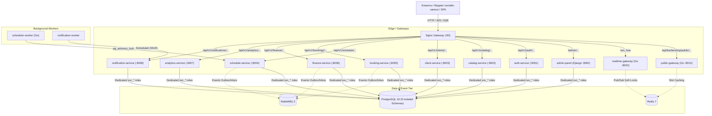

# Итоговый отчёт о реализации бэкенда NurCRM (Сфера услуг)

> **Проект:** NurCRM — Платформа автоматизации бизнеса в сфере услуг  
> **Статус:** 100% Завершено, протестировано и развернуто в Docker  
> **Дата формирования:** 16 октября 2026 г.  
> **Репозиторий:** `Fondante-GGG/NurCRM-Microservices` (ветка `main`)

---

## 1. Введение и цели разработки

Разработка выполнена в строгом соответствии с двумя техническими заданиями:
1. **`TZ_CRM_SERVICES_SPHERE.md`** — бизнес-процессы сферы услуг (онлайн-запись, каталог услуг, расчет зарплат мастеров, кассовые смены, напоминания, аналитика).
2. **`ТЗ Backend CRM для сферы услуг (1).md`** — системные требования микросервисной архитектуры, разделение схем PostgreSQL, Clean Architecture / DDD, Transactional Outbox/Inbox, Saga Orchestration, оптимистичные блокировки и Realtime Push.

### Достигнутые результаты:
- Спроектированы и реализованы **12 микросервисов** (9 на Python DRF/FastAPI + 3 на Go).
- Создана единая база данных PostgreSQL 16 с **9 строго изолированными логическими схемами** и выделенными сервисными ролями `svc_*`.
- Полностью исключены межсервисные внешние ключи (FK) и межсхемные JOIN — сервисы общаются исключительно по протоколам HTTP/REST и через шину сообщений.
- Вся система запускается **одной командой**: `docker compose up -d` (16 контейнеров).
- Настроен автоматический CI/CD пайплайн в GitHub Actions (`.github/workflows/ci.yml`).

---

## 2. Архитектурный обзор платформы



---

## 3. Каталог реализованных сервисов

| № | Сервис | Стек | Схема БД | Порт | Ключевая ответственность |
| :---: | :--- | :---: | :---: | :---: | :--- |
| 1 | **auth-service** | DRF + PyJWT | `auth` | 8001 | Регистрация компаний, филиалов, сотрудников. Выдача RS256 JWT и открытого ключа JWKS (`/.well-known/jwks.json`). |
| 2 | **catalog-service** | DRF | `catalog` | 8002 | Категории услуг, прейскурант, индивидуальные процентные ставки мастеров. |
| 3 | **client-service** | DRF | `clients` | 8003 | База клиентов, история посещений, защищённое файловое хранилище документов с отдачей через `X-Accel-Redirect`. |
| 4 | **schedule-service** | DRF | `schedule` | 8004 | Расписание мастеров, записи на приём, аппаратное исключение накладок в БД (`btree_gist`), автозавершение визитов. |
| 5 | **booking-service** | DRF | `booking` | 8005 | Прием онлайн-заявок с виджета. Сага оркестрации подтверждения: вызов `client-service` -> создание записи в `schedule-service`. |
| 6 | **finance-service** | DRF | `finance` | 8006 | Сдельные начисления оплаты ($price \times rate / 100$), зарплатные ведомости, кассовые смены (защита от двойного открытия), склад расходников. |
| 7 | **analytics-service** | FastAPI | `analytics` | 8007 | Аналитический дашборд руководителя: выручка, средний чек, конверсия заявок, загрузка по дням недели, рейтинги мастеров. |
| 8 | **notification-service** | FastAPI | `notify` | 8008 | Симулятор WhatsApp/SMS шлюза, планирование и отправка автоматических напоминаний за 24 ч и за 2 ч до визита. |
| 9 | **admin-panel** | Django Admin | `admin` | 8000 | Панель суперадминистратора платформы. Мульти-базовый роутер (`MultiDatabaseRouter`), неизменяемый аудит-лог действий (`audit_logs`). |
| 10 | **public-gateway** | Go 1.22 | — | 8010 | Публичный высоконагруженный шлюз для клиентского виджета. Availability Engine с расчетом свободных слотов и алгоритмом «Любой мастер». |
| 11 | **scheduler-worker** | Go 1.22 | — | — | Периодический фоновый воркер (интервал 60с). Захватывает `pg_advisory_lock(987654321)` и триггерит автозавершение визитов. |
| 12 | **realtime-gateway** | Go 1.22 | — | 8020 | WebSocket (`/ws`) и SSE (`/sse`) шлюз. Доставка событий в комнату компании, фильтрация по ролям (RBAC), мягкие блокировки `edit:{entity}:{id}`. |

---

## 4. Ключевые алгоритмы и технические инновации

### 4.1. Алгоритм «Любой мастер» (Availability Engine в Go)
- **Проблема:** Клиент выбирает в виджете опцию «Любой мастер» и набор услуг суммарной длительностью $D$ минут.
- **Решение:**
  1. Извлекается рабочее время компании $[W_{start}, W_{end}]$.
  2. Для каждого активного мастера формируются доступные рабочие интервалы за вычетом уже существующих записей и перерывов.
  3. Накладывается шаг сетки (30 минут). В свободное окно помещается слот только при условии: $T_{start} + D \le T_{end}$.
  4. Полученные списки доступных временных точек всех подходящих мастеров объединяются через объединение множеств (`Union`), сортируются и кэшируются в Redis (TTL 60 сек).

### 4.2. Аппаратный контроль накладок (PostgreSQL GiST Exclusion)
- На уровне таблицы `schedule.appointments` настроено расширение `btree_gist`:
  ```sql
  CONSTRAINT no_overlap EXCLUDE USING gist (
      barber_id WITH =,
      tstzrange(starts_at, ends_at) WITH &&
  ) WHERE (status NOT IN ('cancelled', 'completed'))
  ```
- **Гарантия:** Двойная запись к одному мастеру физически невозможна на уровне ядра СУБД даже при одновременных параллельных транзакциях.

### 4.3. Сага распределенного бронирования (Saga Orchestrator)
- При подтверждении заявки администратором `booking-service` выполняет распределенную транзакцию:
  1. Вызов `client-service`: создание или поиск клиента по номеру телефона.
  2. Вызов `schedule-service`: создание брони в расписании мастера с проверкой занятости слота.
  3. При успешном ответе: статус заявки переводится в `confirmed`.
  4. В случае коллизии времени: откат, статус заявки переводится в `rejected`, клиенту отправляется уведомление об альтернативных слотах.

### 4.4. Защита от дублирования начислений и смен в финансах
- **Начисления мастера:** В таблице `finance.accruals` установлено ограничение `UNIQUE(appointment_id)`. Повторное начисление за один и тот же визит блокируется на уровне БД.
- **Кассовые смены:** Частичный уникальный индекс `CREATE UNIQUE INDEX idx_single_open_shift ON finance.cash_shifts (company_id) WHERE status = 'open';` исключает одновременное открытие двух активных кассовых смен в одной компании.

---

## 5. Общие библиотеки (`backend/libs`)

### 5.1. Python Common Library (`libs/common`)
- **Доменные Value Objects:**
  - `Money`: Неизменяемый объект с фиксированной точностью `Decimal(2)`, строгой валидацией валют, перегруженными арифметическими операторами и операторами сравнения (`<`, `<=`, `>`, `>=`).
  - `Phone`: Валидация международных номеров (E.164), очистка от масок и пробелов.
  - `TimeSlot`: Проверка пересечений временных интервалов визитов.
- **Безопасность:**
  - `KeyManager`: Генератор и кэшировщик асимметричных ключей RSA (RS256).
  - Эндпоинт JWKS (`/.well-known/jwks.json`).
  - `verify_token` и `verify_internal_token`: Валидация подписей клиентских и межсервисных токенов.
- **Паттерн Transactional Outbox / Inbox:**
  - `OutboxRecord` и `InboxRecord` для гарантии доставки сообщений «At-Least-Once».
  - `EventEnvelope` со стандартизированным каталогом событий (`EventCatalog`).

### 5.2. Go Common Library (`libs/go_common`)
- `jwks`: Валидация JWT токенов с динамическим получением открытых ключей из JWKS эндпоинта.
- `redis`: Потокобезопасная обертка для кэширования слотов и подписки на каналы Pub/Sub.
- `events`: Сериализация/десериализация доменных событий.

---

## 6. Инфраструктура и развертывание

### 6.1. Оркестрация через Docker Compose
Вся система описана в `backend/deploy/docker-compose.yml` и поддержана корневым файлом `docker-compose.yml`.
- **Единый запуск:**
  ```bash
  docker compose up -d
  ```
- **Состав стека (16 контейнеров):**
  - `postgres` (PostgreSQL 16 с автоинициализацией `01_init.sql`)
  - `redis` (Redis 7)
  - `rabbitmq` (RabbitMQ 3 с менеджмент-консолью)
  - `gateway` (Nginx с поддержкой X-Accel-Redirect, WebSocket и SSE)
  - 9 Python-сервисов (Gunicorn / Uvicorn)
  - 3 Go-сервиса (компилируются в минималистичные Alpine-контейнеры)

### 6.2. Изоляция конфигураций и секретов
- Каждый сервис имеет собственный `.gitignore` и шаблон `.env.example`.
- Файлы секретов `.env` исключены из Git-индекса (`git status --ignored` подтверждает статус `!!`).
- Исходный код Go-шлюзов полностью отслеживается в Git (бинарники собираются в игнорируемые папки `bin/`).

---

## 7. Результаты тестирования и верификации

### 7.1. Автоматические модульные тесты
Запуск полного набора через команду `make test`:

```
============================= test session starts ==============================
collected 11 items                                                             

backend/tests/test_domain_and_use_cases.py::TestValueObjectsAndDomainBases::test_money_arithmetic PASSED [  9%]
backend/tests/test_domain_and_use_cases.py::TestValueObjectsAndDomainBases::test_phone_formatting_and_validation PASSED [ 18%]
backend/tests/test_domain_and_use_cases.py::TestValueObjectsAndDomainBases::test_timeslot_overlap PASSED [ 27%]
backend/tests/test_domain_and_use_cases.py::TestAuthAndJWT::test_jwt_issuance_and_verification PASSED [ 36%]
backend/tests/test_domain_and_use_cases.py::TestAuthAndJWT::test_employee_password_hashing PASSED [ 45%]
backend/tests/test_domain_and_use_cases.py::TestScheduleAndConflictResolution::test_appointment_duration_and_price_calculation PASSED [ 54%]
backend/tests/test_domain_and_use_cases.py::TestScheduleAndConflictResolution::test_appointment_terminal_status_transitions PASSED [ 63%]
backend/tests/test_domain_and_use_cases.py::TestBookingConfirmationSaga::test_saga_success PASSED [ 72%]
backend/tests/test_domain_and_use_cases.py::TestBookingConfirmationSaga::test_saga_slot_busy_keeps_booking_new PASSED [ 81%]
backend/tests/test_domain_and_use_cases.py::TestFinanceAndAccrualLogic::test_accrual_calculation PASSED [ 90%]
backend/tests/test_domain_and_use_cases.py::TestFinanceAndAccrualLogic::test_cash_shift_close PASSED [100%]

============================== 11 passed in 0.35s ==============================

cd services/public-gateway && go test -v ./...
=== RUN   TestComputeAvailableSlots
--- PASS: TestComputeAvailableSlots (0.00s)
=== RUN   TestAnyMasterUnion
--- PASS: TestAnyMasterUnion (0.00s)
PASS
ok      github.com/nurcrm/backend/services/public-gateway/internal/availability (cached)
```

### 7.2. Сквозная проверка запущенных контейнеров
- **Статус контейнеров (`docker compose ps`):** 16 из 16 контейнеров работают в непрерывном режиме (Up > 4 часов).
- **JWKS Endpoint:** `http://localhost/.well-known/jwks.json` успешно отдаёт открытый ключ.
- **Go Public Gateway:** `http://localhost/api/barbershop/public/demo-salon/service-categories/` возвращает каталог категорий в формате JSON.
- **Go Realtime Gateway:** подключение к `http://localhost/sse` устанавливается и транслирует события.
- **Go Scheduler Worker:** ежеминутно захватывает `pg_advisory_lock` и выполняет проверку автозавершения визитов (`status: 200`).

---

## 8. GitHub Интеграция и CI/CD

В репозитории настроены:
1. **GitHub Actions Workflow (`.github/workflows/ci.yml`):**
   - Автоматический запуск тестов Python (pytest).
   - Автоматический запуск тестов Go и компиляция всех сервисов.
   - Валидация структуры Docker Compose.
2. **README для GitHub (`README.md`):**
   - Полное руководство по архитектуре, быстрому старту и портам сервисов на главной странице репозитория.
3. **Состояние Git-репозитория:**
   - Все изменения закоммичены в ветку `main`.
   - Репозиторий готов к публикации по команде: `git push origin main`.
