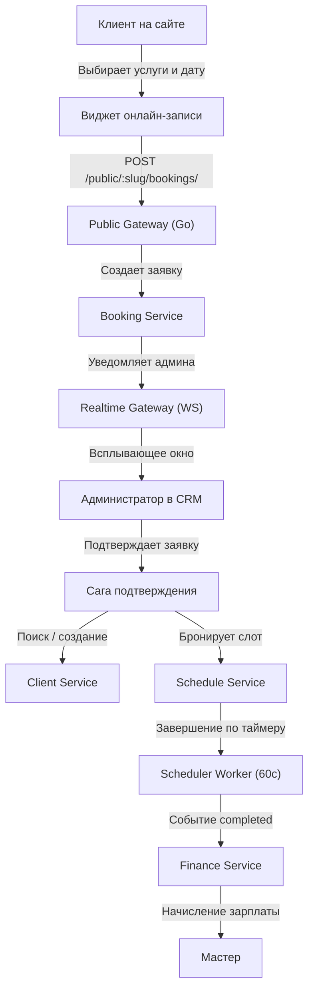

# Product Context: NurCRM для сферы услуг

## 1. Зачем существует проект (Why It Exists)
Бизнес в сфере услуг (салоны красоты, барбершопы, SPA, клиники) критически зависит от плотности расписания мастеров, отсутствия накладок и прозрачности расчетов с персоналом. 
Ручное ведение записи на бумаге или в мессенджерах приводит к:
- Потере клиентов из-за долгого ответа администратора;
- Двойным записям (накладкам) на одно время к одному специалисту;
- Конфликтам при начислении сдельной зарплаты мастерам;
- Непрозрачности кассы и неконтролируемому расходу материалов.

NurCRM решает эти задачи на уровне надежной отказоустойчивой микросервисной системы.

---

## 2. Ролевая модель и ключевые персоны

### Владелец компании (`owner`):
- Полный финансовый контроль (выручка, расходы, чистая прибыль);
- Управление ставками зарплат мастеров (от 0% до 100% за услугу);
- Утверждение выплат зарплат и премий;
- Аналитика бизнеса, пиковых дней и лояльности клиентов.

### Администратор (`admin`):
- Ведение сетки записей в календаре;
- Обработка входящих онлайн-заявок с виджета в 1 клик (сквозная конвертация: клиент + запись);
- Открытие и закрытие кассовых смен, фиксация утреннего остатка и вечерней выручки;
- Загрузка клиентских документов (согласия, карты, фото «до/после»).

### Мастер / Специалист (`master`):
- Просмотр только своего персонального графика (`/api/v1/schedule/appointments/my/`);
- Получение мгновенных оповещений через WebSocket о новых или измененных записях;
- Контроль своих начислений за выполненные процедуры.

### Клиент салона (Публичный пользователь):
- Быстрая запись через веб-виджет без необходимости звонить администратору;
- Выбор удобной даты, перечня процедур и конкретного мастера (или опция «Любой свободный мастер»);
- Получение SMS/WhatsApp напоминаний за 24 часа и за 2 часа до начала.

---

## 3. Ключевые пользовательские сценарии

